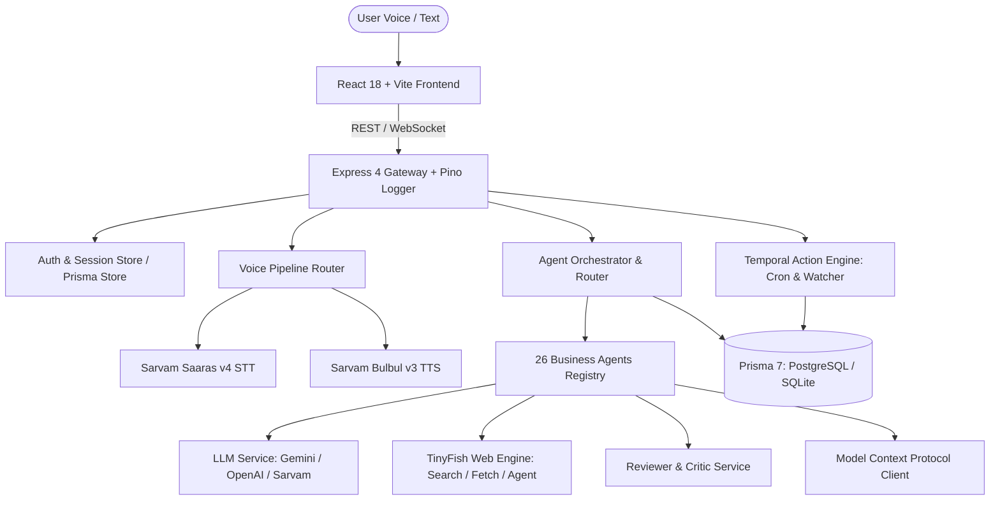

# Vani AI — Architecture Specification

## 1. System Overview

Vani AI is a voice-first, multilingual AI copilot designed for Indian startup founders and operators. It enables natural voice or text conversations in Hindi, Hinglish, English, and regional Indian languages, dynamically orchestrating research, business deliverable generation (BRDs, PRDs, Pitch Decks, Financial Models, GTM Plans), critic evaluations, and integrations.



---

## 2. Directory Structure

- `backend/`: Node 20 + Express 4 ESM API server.
  - `lib/`: Core singletons (`prisma.js`, `logger.js`, `crypto.js`).
  - `routes/`: Express route controllers (`ai.js`, `auth.js`, `document.js`, `project.js`, `task.js`, `voice.js`, `integration.js`, `scheduler.js`, `health.js`).
  - `services/`: Business logic engines (`orchestrator.js`, `agentService.js`, `agentRegistry.js`, `llm.js`, `tinyfish.js`, `sarvam.js`, `reviewerService.js`, `mcpClient.js`, `schedulerService.js`).
  - `prisma/`: Prisma schema files for SQLite (`schema.prisma`) and PostgreSQL (`schema.postgresql.prisma`).
  - `tests/`: Vitest test suites (16 test files covering all functional, security, and eval flows).
- `frontend/`: React 18, Vite 5, TailwindCSS 3 client application.
  - `src/components/`: Modular UI widgets (DocumentViewer, EvidenceInspector, ScheduledActionCard, VoiceHUD, CommandPalette, etc.).
  - `src/pages/`: Main application routes (Home, Workspace, Assistant, Project, Dashboard, Settings, Login).
  - `src/hooks/`: Audio recording and workspace interaction hooks.
- `docs/`: Technical documentation, baseline audit, security policies, and API specifications.

---

## 3. Database Architecture (Dual Adapter)

Vani AI features a dual database adapter supporting zero-dependency local development via SQLite, as well as production deployments on PostgreSQL:

```mermaid
flowchart LR
    PrismaClient[PrismaClient] --> AdapterSwitch{DATABASE_URL Check}
    AdapterSwitch -->|postgresql://| PgAdapter[@prisma/adapter-pg + pg Pool]
    AdapterSwitch -->|file: or sqlite| SqliteAdapter[@prisma/adapter-better-sqlite3]
    PgAdapter --> Postgres[(PostgreSQL Production DB)]
    SqliteAdapter --> SqliteFile[(SQLite dev.db)]
```

- **SQLite Schema**: `backend/prisma/schema.prisma`
- **PostgreSQL Schema**: `backend/prisma/schema.postgresql.prisma`
- **Adapter Loader**: `backend/lib/prisma.js` dynamically initializes the appropriate connection pool adapter based on `process.env.DATABASE_URL`.

---

## 4. Multi-Agent System (26 Agents)

The agent routing engine (`backend/services/agentRegistry.js`) categorizes queries into 26 distinct agent definitions across 4 tiers:

1. **Core Business Deliverables**:
   - `brd`: 29-section Enterprise Business Requirement Documents.
   - `prd`: Product Requirement Documents with user journeys and technical specs.
   - `pitch_deck`: Slide-by-slide pitch outlines with speaker notes and investor hook.
   - `financial_model`: Unit economics, TAM/SAM/SOM, and 3-year P&L projection templates.
   - `gtm_plan`: India-first go-to-market strategies (Tier 1 vs. Tier 2/3 focus, distribution channels).
   - `lean_canvas`: 9-box single-page startup canvas.
   - `india_compliance`: GST, Udyam, DPIIT Startup India registration, Razorpay/UPI checklist.
2. **Analysis & Strategy**:
   - `market_research`, `research`, `idea_discovery`, `idea_validation`, `startup`, `roadmap`, `user_story`, `technical_architect`, `ux_designer`.
3. **Auditing & Simulations**:
   - `reviewer_critic`: Document auditor validating completeness, consistency, Indian-context gaps, and claims.
   - `investor_mock_pitch`: Conversational mock pitch grilling founders with tough investor questions.
4. **Operations & Execution**:
   - `funding`, `student`, `investor`, `hackathon`, `task_command`, `general`, `build`, `plan`.

---

## 5. Live Research & Web Intelligence

When an agent query demands real-time market data or competitor comparison:
1. `backend/services/orchestrator.js` detects research intent via `needsWebResearch(prompt)`.
2. `backend/services/tinyfish.js` triggers concurrent live searches and page extractions.
3. Extracted web text is sanitized and tagged with `<UNTRUSTED_WEB_RESEARCH_DATA>` to prevent prompt injection.
4. Synthesized citations are attached to `AgentRun.metadata.evidence` and displayed in the frontend `EvidenceInspector`.

---

## 6. Model Context Protocol (MCP) & Integrations

`backend/services/mcpClient.js` provides a generic JSON-RPC 2.0 client connecting to external MCP servers over stdio or HTTP SSE.
Supported integrations:
- **GitHub**: Two-way sync of extracted tasks to GitHub repository issues.
- **Slack**: Webhook alerts for scheduled competitor changes and document generation notifications.
- **MCP Tool Plugins**: Dynamic tool invocation enabling external system actions.

---

## 7. Observability & Telemetry

- **Pino HTTP Logging**: Structured JSON logging with automated redaction of sensitive credentials (`token`, `password`, `key`, `secret`, `authorization`).
- **Request Tracing**: `x-request-id` correlation header propagated across every incoming request and log entry.
- **Health Probes**:
  - `GET /api/health/live`: Liveness check (process alive).
  - `GET /api/health/ready`: Readiness check (database query ping).
  - `GET /api/health`: Comprehensive system status with provider availability.
- **Cost & Token Tracking**: Every agent execution records `promptTokens`, `completionTokens`, `totalTokens`, and estimated cost in `AgentRun`.
